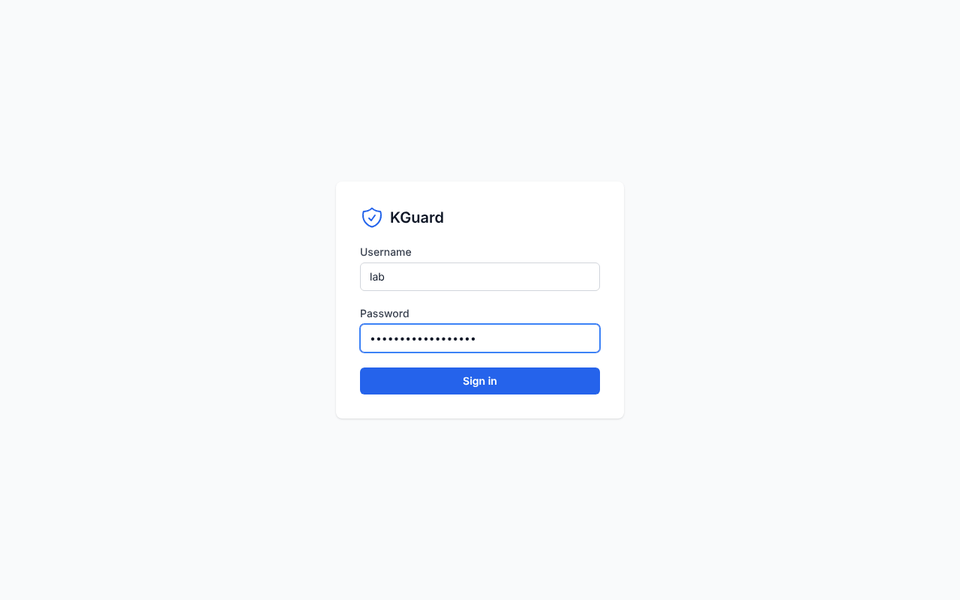
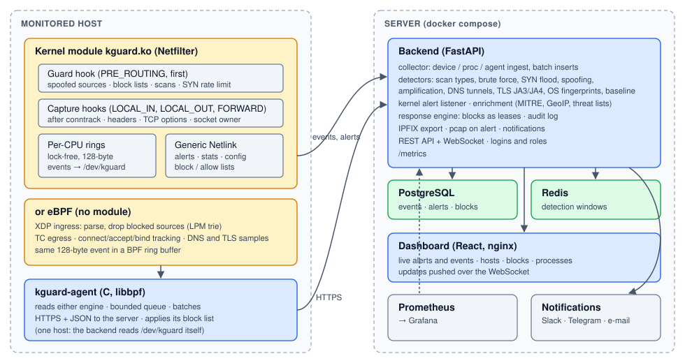

# KGuard

[](https://github.com/vishesh711/KGuard-Kernel-Level-Port-Monitoring-Security-Dashboard/actions/workflows/ci.yml)
[](https://github.com/vishesh711/KGuard-Kernel-Level-Port-Monitoring-Security-Dashboard/actions/workflows/debug-kernel.yml)
[](LICENSE)

KGuard watches every connection attempt on a Linux host from inside the
kernel, detects scans, floods, brute force, spoofing, amplification, DNS
tunnels and known-bad TLS clients, can block attackers in the kernel, and
shows it all live in a web dashboard.



*Recorded in a VM by [`scripts/demo/make_demo.sh`](scripts/demo/make_demo.sh): the
kernel module is loaded and nmap and hping3 attack the host from another
network namespace. Nothing in it is simulated.*

## What it does

- **Captures in the kernel.** A Netfilter module records every packet that
  opens or uses a connection (IPv4 and IPv6, in, out and forwarded, in every
  network namespace) with its conntrack state, TCP fingerprint and the
  process behind it, into lock-free per-CPU rings that user space reads
  with `mmap()`. Or, without a module, an eBPF engine (XDP and TC) does the
  same and also samples DNS and TLS handshakes.
- **Detects and blocks in the kernel** what must be stopped at line rate:
  port scans, SYN floods from one source, spoofed sources. Blocking is off
  until you turn it on, and the host's own addresses can never be blocked.
- **Detects in the backend** what needs history or payloads: scan types
  (SYN, FIN, NULL, Xmas, ACK, Maimon, UDP), brute force, distributed SYN
  floods, TTL-based spoofing, amplification, DNS tunnelling, JA3/JA4 TLS
  fingerprints, OS fingerprints, traffic baselines, threat lists.
- **Runs on many hosts**: a C agent ships events from each host to one
  backend, and enforces its block list there.
- **Fits in**: Prometheus metrics and a Grafana dashboard, Slack, Telegram
  and e-mail alerts, IPFIX flow export, a pcap of the packets around each
  serious alert, PostgreSQL, logins with viewer and admin roles.



How each part works and why it is built that way: [docs/DESIGN.md](docs/DESIGN.md).

## Measured

Every number here links to where it was measured. KGuard has not yet been
measured on real hardware, so there is no packets-per-second claim.

| | Result | Source |
|---|---|---|
| Kernels | Module builds and passes 84/84 kernel checks on Linux 5.15, 6.1, 6.6, 6.12 and 7.3 | [CI kernel matrix](.github/workflows/ci.yml), [P8.5](ROADMAP.md) |
| Attacks | 8 of 8 attack demos raise the right alert (35 checks): nmap scan types, hydra, hping3 floods, OS fingerprints, spoofing, amplification, iodine DNS tunnel, TLS | [`make attack-demo`](scripts/attack_demo.sh), [P8.2](ROADMAP.md) |
| Speed of detection | nmap SYN scan reported 21 ms after its first SYN | [K3.2](ROADMAP.md) |
| Live dashboard | 26-72 ms from an agent sending an event to its row on screen (8 runs) | [U7.1](ROADMAP.md) |
| Lossless capture | 40,000 events at 5,000/s, none dropped | [K2.3](ROADMAP.md) |
| Bounded memory | 1,000,000 spoofed sources keep the tracking table under its cap of 65,536 | [K3.1](ROADMAP.md) |
| Kernel bug checkers | No lockdep, KCSAN, KASAN or UBSAN report involving kguard; no leak (kmemleak) | ["Debug kernels" workflow](.github/workflows/debug-kernel.yml), [P8.3](ROADMAP.md) |
| Static analysis | sparse, smatch and checkpatch `--strict` clean | [CI](.github/workflows/ci.yml), [P8.4](ROADMAP.md) |
| Fuzzing | Packet parsers: 2.48 billion inputs (TCP options, C) and 209 million (TLS, DNS), no crash; nightly in CI | [P8.8](ROADMAP.md), [fuzz workflow](.github/workflows/fuzz.yml) |
| Backend tests | 89% coverage | [CI](.github/workflows/ci.yml), [P8.9](ROADMAP.md) |
| Cost per packet | Measured in an emulated VM only, which inflates it many times over | [docs/BENCHMARKS.md](docs/BENCHMARKS.md) |

What it does not catch, and how it can be evaded: [docs/THREAT_MODEL.md](docs/THREAT_MODEL.md).

## Quick start

On a Linux host with Docker, Docker Compose v2 and the kernel headers:

```bash
git clone https://github.com/vishesh711/KGuard-Kernel-Level-Port-Monitoring-Security-Dashboard.git kguard
cd kguard
make setup                    # creates .env: fill in the secrets it lists
make -C kernel
sudo modprobe -a nf_conntrack nf_socket_ipv4 nf_socket_ipv6
sudo insmod kernel/kguard.ko reader_gid=1500
docker compose -f docker-compose.prod.yml -f docker-compose.kernel.yml up -d --build
```

Open `http://localhost/` and log in with `ADMIN_USERNAME` / `ADMIN_PASSWORD`
from `.env`. The module starts in monitor-only mode: it drops nothing until
you set `enforce=1`.

A permanent install (DKMS), TLS, agents on more hosts, monitoring and
upgrades: [docs/DEPLOYMENT.md](docs/DEPLOYMENT.md).

## Repository

| Path | What |
|---|---|
| [`kernel/`](kernel/README.md) | The Netfilter module, its UAPI header, `kguardctl`, and its tests (VM suite, selftests, fuzzer) |
| [`agent/`](agent/README.md) | `kguard-agent`: eBPF programs and the C agent |
| [`backend/`](backend/README.md) | FastAPI backend: collection, detection, response, API |
| [`frontend/`](frontend/README.md) | React dashboard |
| [`scripts/`](scripts) | Attack demos, the two-VM lab, benchmarks, the demo recording |
| [`monitoring/`](monitoring) | Prometheus and Grafana configuration |
| [`docs/`](docs/README.md) | Design, threat model, deployment, benchmarks, API reference |
| [`ROADMAP.md`](ROADMAP.md) | Everything that was built, and how each item was verified |

## Development

```bash
make test           # backend (pytest) and frontend (Vitest)
make test-kernel    # the kernel suite in a throwaway VM (virtme-ng)
make attack-demo    # real attacks in a VM, pass/fail per attack
make lab            # victim and attacker VMs on a private link
make bench          # packet-rate benchmarks in a VM
```

CI runs the backend and frontend tests, the kernel suite and selftests in
KVM guests on five kernels, static analysis, and the debug-kernel builds.
The attack demos, the lab and the benchmarks need a few minutes to an hour
in a VM and are run by hand.

## License

GNU General Public License v2.0 ([LICENSE](LICENSE)). The kernel module must
be GPL-compatible to use the kernel interfaces it needs.
