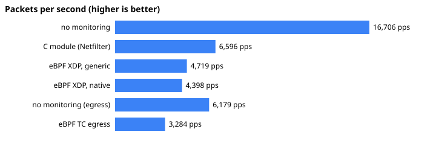
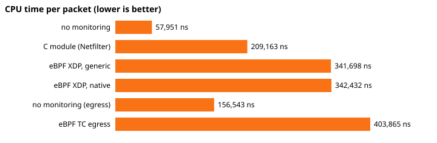

# KGuard benchmarks

What monitoring costs: packets per second, CPU time per packet and losses
for no monitoring, the C kernel module and the eBPF agent (XDP generic, XDP
native, TC egress), with perf flame graphs (roadmap P8.7).

> **Read this first.** These numbers come from an **emulated** VM (QEMU
> TCG, no KVM) on a 4-CPU cloud container. Emulation makes every
> instruction tens of times slower than on hardware, and not equally so:
> it penalises some code paths more than others. Use the numbers to see
> that the harness works and to compare modes roughly. Do not use them as
> the cost of KGuard on a real machine. To get real figures, run
> `make bench` on hardware or a KVM guest (see [Reproducing](#reproducing)).

## Setup

| | |
|---|---|
| Host | Intel Xeon @ 2.10 GHz, 4 CPUs, Linux 6.18 container, **no `/dev/kvm`** |
| VM | QEMU 8.2.2, TCG (software emulation), 4 vCPUs, 2 GB, virtme-ng 1.42 |
| Guest kernel | Ubuntu 6.8.0-147-generic |
| Traffic | `trafgen` 0.6.8 on one CPU: 60-byte UDP frames (64 on the wire) over a veth pair into a network namespace |
| Run | 10 s measurement window per mode, after 1 s of warm-up; 3 repeats; table shows the median and [range] |
| Date | 2026-11-10, commit of this file |

Raw data: [`bench/results.json`](bench/results.json). Script:
[`scripts/benchmark.py`](../scripts/benchmark.py) (run in a VM by
[`scripts/bench_vm.sh`](../scripts/bench_vm.sh)); tables and charts:
[`scripts/bench_report.py`](../scripts/bench_report.py).

### What each column means

- **Packets/s**: packets that reached IP in the receiving namespace (`Ip InReceives`) during the window.
  The receiving veth's own counter agrees with this to within a few packets in every run, and no
  packets were dropped from full per-CPU backlog queues. So the generator's rate, slowed by the
  monitoring, is what sets these numbers.
- **CPU ns/packet**: kernel, IRQ and softirq time across all CPUs (`/proc/stat`), per packet received.
  This includes the generator's own sending cost, which is why the baseline is not zero.
- **Added ns/packet**: CPU ns/packet minus the baseline in the same direction.
- **Own ns/packet**: the component's own measure. For the module, its sampled hook cost
  (`ns_per_packet` over Generic Netlink). For eBPF, the program's `run_time_ns / run_cnt` with
  `kernel.bpf_stats_enabled=1`: XDP for ingress, TC egress for egress.
- **Events lost**: ring-buffer drops (module rings, or the agent's BPF ring buffer).

## Results

Ingress: frames flood into the namespace where the monitoring runs.
Egress: frames are sent out of that namespace through the qdisc layer, so
they pass the agent's TC egress program.

| Mode | Packets/s | CPU ns/packet | Added ns/packet | Own ns/packet | Events lost |
|---|---:|---:|---:|---:|---:|
| no monitoring | 16,706 [15,984–21,642] | 57,951 [44,860–60,652] | – | – | – |
| C module (Netfilter) | 6,596 [5,503–6,664] | 209,163 [202,797–246,947] | +151,212 | 43,059 [39,890–45,750] | 0 |
| eBPF XDP, generic | 4,719 [4,346–4,884] | 341,698 [301,859–347,016] | +283,747 | 73,096 [67,954–79,650] | 0 |
| eBPF XDP, native | 4,398 [3,833–4,730] | 342,432 [328,348–374,128] | +284,481 | 78,120 [71,547–78,349] | 0 |
| no monitoring (egress) | 6,179 [4,544–7,083] | 156,543 [136,843–212,037] | – | – | – |
| eBPF TC egress | 3,284 [3,076–4,861] | 403,865 [285,626–443,933] | +247,323 | 1,327 [968–1,915] | 0 |





### Flame graphs

One 10 s `perf record -a -g` profile per mode, taken in a separate window
right after the measurement, so perf's own cost stays out of the table:

[no monitoring](bench/flame-none.svg) ·
[C module](bench/flame-module.svg) ·
[eBPF XDP generic](bench/flame-ebpf-generic.svg) ·
[eBPF XDP native](bench/flame-ebpf-native.svg) ·
[no monitoring, egress](bench/flame-none-egress.svg) ·
[eBPF TC egress](bench/flame-ebpf-tc.svg)

What they show:

- **C module:** KGuard's own frames are about 16% of all samples:
  `kguard_guard_hook` 5.9%, `kguard_track_attempt` 5.3%, `kguard_hook`
  5.1%. The user-space reader draining the rings (`kguard_reader`) is 3.2%.
  The rest is the stack itself (`nf_hook_slow`, IP, UDP) and the generator.
- **eBPF XDP generic:** the XDP program (`bpf_prog_…_kguard_xdp`) is 10.9%
  of samples, inside `netif_receive_generic_xdp` (12.7%). The agent process
  reading the ring buffer is 3.5%.
- **eBPF TC egress:** the TC program does not show up at all. At about
  1.3 µs per run it is too cheap to be sampled. The XDP program still takes
  7%, running on the traffic that comes back into the namespace (ICMP port
  unreachable replies).

## Reading the numbers

- **Every mode loses no events.** At these rates the rings and the ring buffer keep up. This is
  the one result that should carry over to hardware unchanged; real rates are far higher, so
  ring sizing still needs checking there.
- **The module costs less per packet than the eBPF XDP program here** (43 µs vs 73–78 µs of own
  time). Under emulation this comparison is unreliable: JIT-compiled BPF code and the module's C
  code are both emulated, at different slowdowns. The module also does more (conntrack state,
  socket lookup, scan tracking). Hardware numbers are needed before drawing a conclusion.
- **Generic and native XDP cost the same here.** That is expected on a veth: native XDP on a veth
  still builds a socket buffer for the stack, and its real advantage (no allocation before the
  program runs) shows on physical NICs with driver support.
- **The TC egress program is far cheaper per run than the XDP program** (about 1.3 µs vs 75 µs).
  This is not explained yet. Payload capture was off (the agent runs with `--no-payloads` in the
  benchmark), both programs parse headers, look up the socket owner and emit an event, and only
  XDP adds an LPM blocklist lookup, which should not cost 50 times more. It may be an artefact of
  emulation or of where the kernel's run-time accounting starts for each hook. Profiling on
  hardware is the next step.
- **The egress baseline is noisy** (4,544–7,083 packets/s). Sending through the qdisc path from a
  namespace under emulation varies a lot between runs, so the egress "added" figure has wide
  error bars.

## Known issues found while benchmarking

- **pktgen + generic XDP crashes the 6.8 kernel.** pktgen reuses one socket buffer with extra
  references. Generic XDP on the receiving veth then calls `pskb_expand_head()` on that shared
  buffer, which is a `BUG()` ("kernel BUG at net/core/skbuff.c:2138", from
  `netif_receive_generic_xdp`, `Comm: kpktgend_0`). This is a kernel pktgen/XDP interaction, not
  KGuard code. For that reason trafgen is the default generator. pktgen is still available
  (`--generator pktgen`), and the script refuses to combine it with generic XDP.
- **The veth sometimes stays referenced at teardown.** After some runs, deleting the veth logs
  `unregister_netdevice: waiting for bsend to become free. Usage count = 2` and never finishes.
  It was seen at the end of the full sequence, with and without perf; the eBPF-native → egress
  pair and the egress modes alone did not reproduce it. The cause is not identified yet. The
  script now gives up on teardown after 30 s instead of hanging.

## Reproducing

```bash
make bench                                     # every mode, 3 repeats, flame graphs, in a VM
scripts/bench_vm.sh --seconds 10 --repeat 3    # without flame graphs
scripts/bench_vm.sh --modes none,module        # a subset
python3 scripts/bench_report.py docs/bench/results.json   # table + pps.svg/cost.svg
```

`scripts/benchmark.py` can also run directly as root on a test machine
(not one you care about: it loads the module and floods a veth pair).
Needs: `trafgen` (netsniff-ng), `bpftool`, `perf` for flame graphs, the
built module (`make -C kernel`, `make -C kernel tools`) and agent
(`make -C agent`). `bench_vm.sh` uses KVM when `/dev/kvm` exists, and
`results.json` records which accelerator ran.
